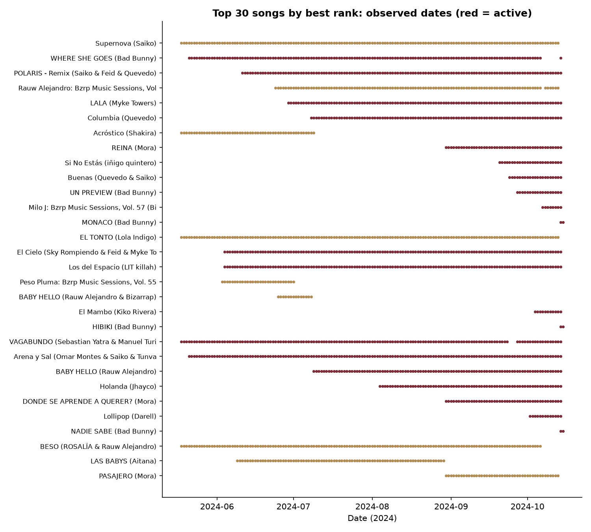
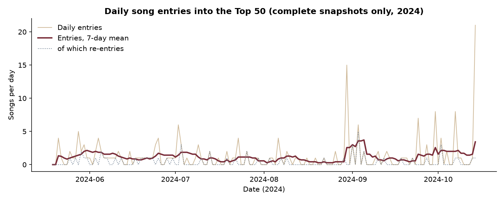
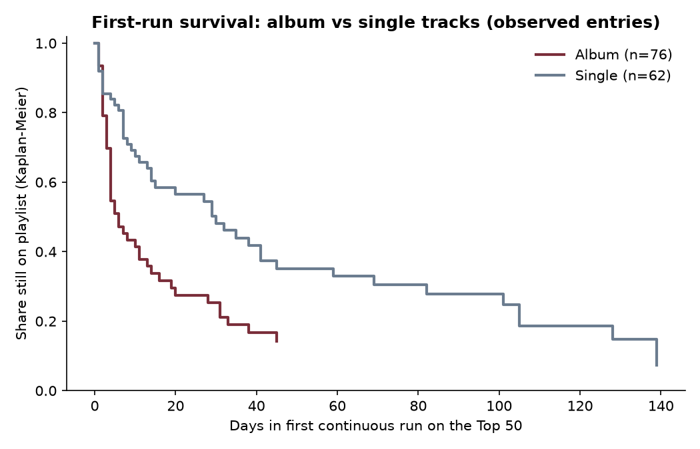
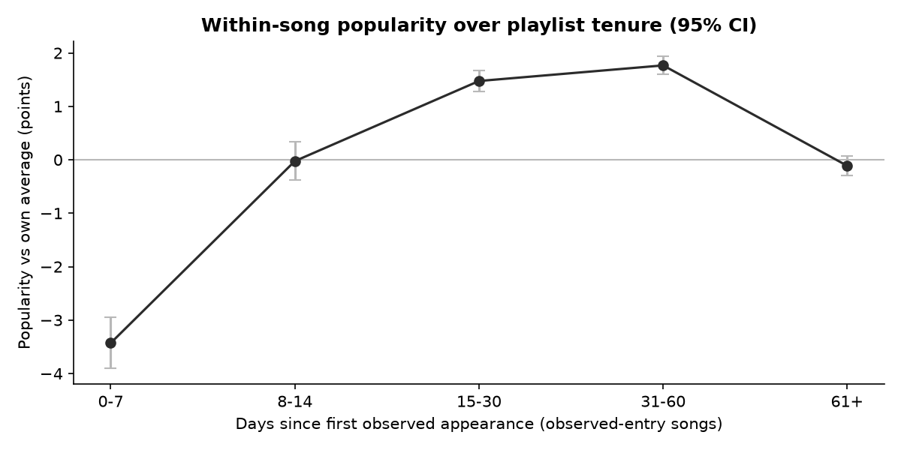

# Lifecycle, Rotation and Content Maturity of Songs on the Spain Top 50 Playlist, May–October 2024

**Client context:** Atlantic Recording Corporation
**Data period:** 18 May 2024 to 15 October 2024 (historical). These findings describe 2024 and must not be read as describing current (2026) market behaviour.

## Abstract
We analyse 7,508 song-date observations from 151 daily snapshots of the Spain Top 50 playlist. One snapshot (15 October 2024) is incomplete, with 8 of 50 positions, and is excluded from all transition and exit calculations. Across 188 songs, 198 entries and 198 exits were observed, of which 60 entries were re-entries. Mean daily playlist churn was 2.66% (1.33 songs per day). Album tracks left the playlist sooner than singles: among songs whose entry was observed, the median number of appearances was 4 for albums and 26 for singles. This difference is robust to alternative attribute rules and to removing the 14 October 2024 entry cohort, although its strength drops. Explicit and clean tracks showed no significant difference once censoring was handled. Duration showed no association with tenure, rank or popularity. Popularity rose over the first month of a song's tenure. We report these as associations within one historical window, not as causal effects.

## 1. Introduction
Playlist positions change daily. Labels want to know how quickly songs reach their peak, how long they stay, and whether content attributes such as album format or explicit content relate to that pattern. This study uses one playlist's daily snapshots to measure lifecycle and rotation, and to test a small set of content-attribute comparisons with corrections for multiple testing and for the censoring inherent in a finite observation window.

## 2. Spain music market context
This study uses only the supplied dataset. No external market statistics are used. The findings describe one playlist's rotation during one period in 2024.

## 3. Problem statement
How do songs enter, rise, decline and leave a fixed 50-position playlist? Do explicit content, album format, duration or album size relate to observed tenure and rank?

## 4. Research objectives
1. Build a reproducible song-level lifecycle from daily snapshots, accounting for censoring and re-entry.
2. Measure playlist rotation (entries, exits, turnover, retention) on valid consecutive complete snapshots.
3. Test whether explicit content, album format, duration and album size relate to lifecycle outcomes, with appropriate statistics.
4. Examine how popularity changes over a song's tenure.

## 5. Dataset description
The file has 7,508 rows and 10 columns (date, position, song, artist, popularity, duration_ms, album_type, total_tracks, is_explicit, album_cover_url). It covers 151 consecutive calendar days. 150 dates have exactly 50 songs in positions 1 to 50. 15 October 2024 has 8 songs (positions 1 to 8). 188 songs were observed, of which 181 have distinct normalised titles and 101 distinct artist credits.

## 6. Data validation
- No missing values, no unparseable dates, no out-of-range positions, no exact duplicate rows and no duplicate (date, position) pairs.
- 14 titles appear under more than one artist credit. These are flagged and **not** merged.
- Attribute conflicts affect 9 songs (32 song-attribute-value rows). Most (`one_way_switch`) look like real version changes. One is interleaved. Canonical values are used only for song-level analysis; originals are preserved.
- Popularity 0 appears on 61 rows and is treated as missing. The non-zero minimum is 3.
- Full checks are in `outputs/reports/`.

## 7. Methodology
Full definitions are in `docs/methodology.md`. In summary:
- **Lifecycle:** songs are described by continuous runs, re-entries and cumulative appearances. Songs present on the first observed date are *left-censored*. Songs present at the end of the complete window (14 October 2024) are *right-censored* and are not treated as exits. An exit is observed only when a song is absent on the next complete day.
- **Rotation:** for each consecutive pair of complete days, entries and exits are counted against a fixed playlist of 50. Turnover is (entries + exits)/2, as specified.
- **Stage:** a rule-based classification (New Entry, Growth, Peak, Mature, Decline) is applied to active songs, with thresholds fixed in advance and documented.
- **Statistics:** Kaplan–Meier curves and log-rank tests on first-run survival of observed-entry songs; Mann–Whitney U with rank-biserial effect sizes; Spearman correlations; a seeded permutation test where chi-square expected counts are small; Holm correction across the family of primary tests.

## 8. Song lifecycle construction

- Of 188 songs, 138 entered during the window and 50 were already on the chart on 18 May 2024.
- At 14 October 2024, 50 songs were active. 138 had exited, and 35 songs had at least one re-entry (60 re-entry events in total).
- The best-ranked songs typically reached their best position early. For observed-entry songs, the median time to peak was 0 days: 60% reached their best position on their first observed day. This reflects a debut peak followed by decline, not the time to peak in the wider release lifecycle.
- The median observed span of exited songs (first to last appearance) was 9.5 days (bootstrap 95% CI 7 to 17). Right-censoring means this is an estimate for songs that have already left, so it is biased short for long-running songs.

## 9. Playlist rotation analysis
- 149 valid transitions. Mean daily entry and exit rates were 2.66% each, so mean daily turnover was 1.33 songs.
- Entries equal exits every day by construction, since each complete snapshot holds 50 songs. Daily turnover therefore equals daily entries.
- 198 entries occurred, 60 of them re-entries (30%). 64 of 149 transitions (43%) had no entries.
- Monthly average daily turnover: May 1.54, June 1.20, July 1.00, August 1.06, September 1.33, October 2.71 (October includes 14 October, the highest-rotation day in the window: 21 entries, of which 20 were first appearances and 19 of those 20 were by Bad Bunny).
- Figures: `outputs/figures/daily_entries_exits.png`, `outputs/figures/monthly_turnover.png`.

**The 14 October 2024 entry wave.** 20 songs first appeared on 14 October, and 19 of them are by Bad Bunny. On 15 October, the partial snapshot contains only Bad Bunny songs in positions 1 to 8. The data do not record the cause of this wave, and we make no claim about it. Because these songs have very short observed tenure, the wave influences the album and stage comparisons, as discussed below.

## 10. Content maturity analysis

### 10.1 Explicit vs clean
Observed-entry songs: 80 explicit and 58 clean (of 94 each overall; the remainder were already on the chart on day 1).

| Measure (observed-entry songs) | Explicit | Clean | Test | p (raw) | p (Holm family) |
|---|---|---|---|---|---|
| Median cumulative appearances | 7.5 | 11.0 | Mann–Whitney | 0.073 | 0.58 |
| First-run survival, median (days) | 16 | 11 | Log-rank | 0.89 | 1.00 |
| Median mean popularity | 80.8 | 79.5 | Mann–Whitney | 0.65 | 1.00 |
| Median best position | 16 | 21 | Mann–Whitney | 0.23 | 1.00 |

No measure is significant after correction. The all-songs appearance comparison (p = 0.0008) was an artifact: explicit songs were far less often present on day 1 (14 of 94, compared with 36 of 94 clean songs), so their tenure was measured on a different footing. Removing the 14 October cohort also gives no difference (p = 0.74). Active explicit songs are concentrated in the 14 October wave (20 of 32 are New Entries), so the stage association (p = 0.003; permutation p = 0.0003) reflects that wave, not lifecycle maturity. We do not claim an explicit-content effect.

### 10.2 Singles vs album tracks

Observed-entry songs: 76 albums and 62 singles.

| Measure (observed-entry songs) | Album | Single | Test | p (raw) | p (Holm family) |
|---|---|---|---|---|---|
| Median cumulative appearances | 4 | 26 | Mann–Whitney, rank-biserial −0.50 | < 0.001 | < 0.001 |
| First-run survival, median (days) | 6 | 30 | Log-rank | 0.003 | 0.064 |
| Median time to peak (days) | 0 | 2 | Mann–Whitney | < 0.001 | < 0.001 |
| Median mean popularity | 78.1 | 81.2 | Mann–Whitney | 0.006 | 0.13 |
| Median best position | 18 | 19 | Mann–Whitney | 0.22 | 1.00 |

Singles stayed on the playlist longer, and this is the most robust result in the study. Excluding the 14 October cohort (which is mostly albums) leaves the appearance difference significant (p = 0.0008; medians 6.5 for albums and 26 for singles), though weaker. The alternative attribute rule changes 4 songs' album status, and the result stays significant (p < 0.001). Album and single songs did not differ in best rank or rank volatility. Singles had higher popularity medians, but this is not significant after correction.

### 10.3 Duration
Duration showed no association with cumulative appearances, best position, mean popularity, re-entries or time to peak (|Spearman rho| ≤ 0.11; all p > 0.17; all Holm-adjusted p = 1.0). Quartile comparison of appearances: Kruskal–Wallis p = 0.93.

### 10.4 Album size
Across all songs, total tracks correlated with appearances (rho = −0.43), but this is confounded by format, because singles have one track. Within albums (n = 97), the association with appearances is negative (rho = −0.40; Holm-adjusted p = 0.001), with mean popularity positive but not significant (rho = 0.14), and with best position and time to peak not significant after correction. Larger albums appear to stay on the chart for fewer days. This is a within-album association, not evidence that adding tracks shortens tenure.

## 11. Popularity analysis

- Popularity is recorded daily, so changes over tenure can be measured. For 102 observed-entry songs with at least two valid readings, popularity rose from first to last observation in 94% of cases (median change +10.5 points; Wilcoxon p < 0.001).
- Within-song deviation from each song's mean is lowest in the first week (−3.4 points, n = 122 songs). It rises to about +1.5 to +1.8 points in days 15–60, and returns to about zero after 60 days (n = 23 songs, so this estimate is imprecise). Later buckets are affected by which songs are still present.
- Popularity is associated with rank: higher maximum popularity goes with better best position (Spearman rho = −0.44; p < 0.001). Mean popularity shows rho = −0.38. First-observed popularity does not (rho = −0.08; p = 0.27). These are same-period associations, not evidence that popularity causes rank.
- Popularity did not differ significantly across lifecycle stages (Kruskal–Wallis p = 0.10).
- Figures: `outputs/figures/popularity_by_tenure.png`, `outputs/figures/popularity_vs_rank.png`.

## 12. Statistical analysis summary
- Primary tests were corrected with Holm across a family of 27 tests. Album appearance differences, album time to peak, and album-size association within albums remain significant after correction.
- Album first-run survival (p = 0.064) and album popularity (p = 0.13) are not significant after correction.
- Explicit-content tests are not significant after correction.
- Associations between attributes and outcomes are not causal. Several are confounded by format, censoring and the 14 October cohort, as discussed.

## 13. Results and findings
1. Songs turn over at a steady rate of about one song per day in this window. About 30% of entries are re-entries.
2. Album tracks leave the playlist much sooner than singles. This holds across attribute rules and survives removing the 14 October cohort, though the survival-curve difference is borderline after correction.
3. Explicit content shows no reliable relationship with tenure, rank or popularity.
4. Duration shows no relationship with any outcome.
5. Popularity rises over the first month of a song's tenure and is associated with better rank, but these associations are not tested for causation.

## 14. Strategic implications
- Rotation is steady and close to one replacement per day. Playlist positions are contested continuously, not seasonally.
- Singles are associated with longer tenure than album tracks in this window. The album effect may partly reflect how album tracks enter the chart, and in this window it coincided with a large single-artist wave.
- Debut peaks are common: most songs reached their best position on their first observed day.

## 15. Recommendations
1. Track entry-day performance separately from later decline, since many songs peak at entry.
2. Investigate the 14 October 2024 wave with release metadata before drawing strategic conclusions about album tracks.
3. Collect release dates and first-appearance dates from an external source. The dataset cannot confirm release-to-playlist timing.
4. Obtain the full 15 October 2024 snapshot to verify the 42 missing positions.
5. Resolve the 14 shared-title song identities and the 9 attribute conflicts with the data owner.

## 16. Limitations
- **Historical data.** 18 May to 15 October 2024 only. Findings do not describe 2026.
- **Censoring.** 50 songs were present on day 1 (entry unknown) and 50 were still active at window end (exit unknown). Survival estimates are for observed-entry songs and are biased for long-running songs.
- **Incomplete snapshot.** 15 October 2024 has 8 of 50 positions. Its absences are not treated as exits, but a complete snapshot would be needed to confirm them.
- **Single playlist.** Results describe one playlist and cannot be generalised to other charts.
- **Identity.** Songs credited to different artist strings were kept separate, which may split some tracks.
- **Popularity.** Zero values were treated as missing. This is an assumption, supported by the non-zero minimum of 3 and by their clustering on specific dates.
- **Confounding.** Format, duration, album size, explicit status and release timing are correlated. Associations are not causal.
- **Market context.** No external market data was used.

## 17. Conclusion
In this historical window, the Spain Top 50 rotated about one song per day, and about 30% of entries were re-entries. Singles were associated with longer tenure than album tracks. This is the most robust content finding, although it is weakened by the 14 October 2024 wave. Explicit status and duration showed no reliable relationship with lifecycle outcomes. Popularity rises over the first month of tenure. These results are descriptive and historical. A current or causal analysis would need data beyond this dataset.

## 18. References
- Cramér, H. (1946). *Mathematical Methods of Statistics*. Princeton University Press.
- Cureton, E. E. (1956). Rank-biserial correlation. *Psychometrika*, 21(3), 287–290.
- Holm, S. (1979). A simple sequentially rejective multiple test procedure. *Scandinavian Journal of Statistics*, 6(2), 65–70.
- Kaplan, E. L., & Meier, P. (1958). Nonparametric estimation from incomplete observations. *Journal of the American Statistical Association*, 53(282), 457–481.
- Mann, H. B., & Whitney, D. R. (1947). On a test of whether one of two random variables is stochastically larger than the other. *The Annals of Mathematical Statistics*, 18(1), 50–60.
- Spearman, C. (1904). The proof and measurement of association between two things. *The American Journal of Psychology*, 15(1), 72–101.
